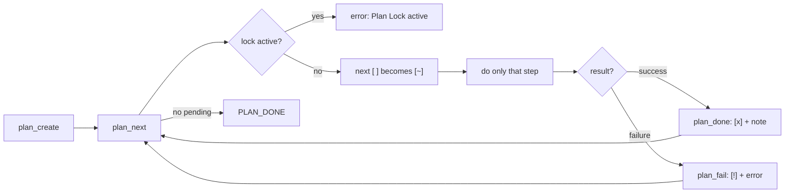
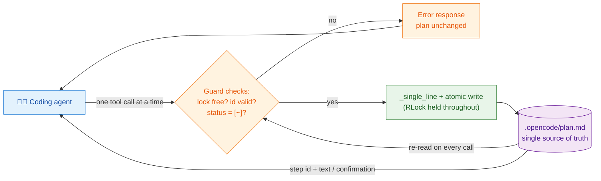
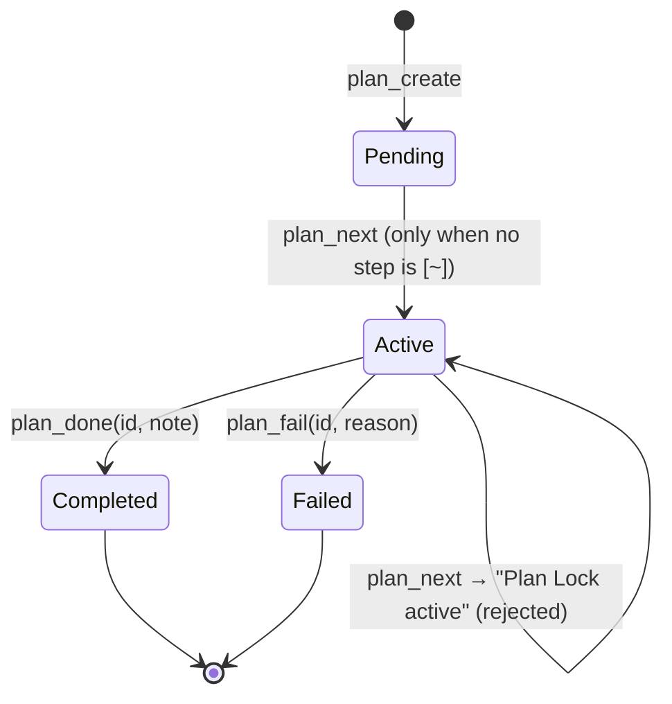

# Plan Lock MCP

Plan Lock MCP makes an LLM work through a markdown plan one atomic step at a time, holding a lock on the active step until it is resolved.

[English](./README.md) | [Türkçe](./README.tr.md)

## The Problem

Local coding models — especially the 30B class such as Qwen3-Coder — tend to emit eight to ten tool and shell calls in a single turn when asked to change code. Every call returns its output into the same conversation. The context window fills with interleaved command output, it becomes hard to tell which result belongs to which command, and a failed step is buried next to unrelated successful ones.

On the following turn the model has to re-derive "where was I" from that noisy history. On local hardware this is expensive: the KV cache is extended with tokens that describe bookkeeping rather than progress.

The result is slower and more chaotic work. Parallelism is often presented as a speedup, but for a local LLM it usually does the opposite: more output to parse, more state to reconcile, and a higher chance that one failing call invalidates the others.

## The Idea

- **One atomic, verifiable step at a time.** A step has a clear boundary: it is started, then either completed with a note or failed with a reason.
- **The plan lives outside the model.** It is a markdown file, not a conversation history. The model re-reads it when it needs state instead of carrying the whole task history in context.
- **The lock is enforced by the server, not by the prompt.** While a step is `[~]`, `plan_next` refuses to activate another one. Discipline is a property of the tool layer.
- **Transitions are idempotent and crash-safe:** `[ ]` → `[~]` → `[x]` / `[!]`. State is on disk, so after a crash or restart the model continues from the marked step rather than guessing.

## How it works

The usual loop is:

1. `plan_create(steps)` writes a fresh plan and backs up any previous one.
2. `plan_next()` activates the first pending step and returns its id and text.
3. The model does only that step, then calls `plan_done(id, note)` or `plan_fail(id, reason)`.
4. Repeat. `plan_next()` returns `PLAN_DONE` when no pending steps remain.



| Tool | Parameters | Behaviour |
| :--- | :--- | :--- |
| `plan_create` | `steps: list[str]` | Writes `.opencode/plan.md`, prepares `.opencode/.gitignore`, backs up an existing plan. |
| `plan_next` | none | Activates the next `[ ]` step as `[~]`. Returns an error if a step is already `[~]`, or `PLAN_DONE` when finished. |
| `plan_done` | `id: int, note: str` | Marks the active `[~]` step as `[x]` and appends the note. |
| `plan_fail` | `id: int, reason: str` | Marks the active `[~]` step as `[!]` and appends the reason. |

A step cannot be started twice: the server checks the active lock before activating anything else. Completed and failed steps are terminal.

## Plan file

The plan is stored at `.opencode/plan.md`, relative to the current working directory. There is no hardcoded path and nothing is written to the home directory, so each project keeps its own independent plan.

```markdown
# Plan — myproject
- created: 1732451234

- [ ] 1. Create database schema
- [~] 2. Implement API endpoints
- [x] 3. Configure authentication — note: JWT tokens configured
- [!] 4. Set up Redis cache — error: Connection timeout
```

The header records the project name (basename of the working directory) and the creation time as a unix timestamp.

| Marker | Meaning |
| :---: | :--- |
| `[ ]` | Pending. |
| `[~]` | Active (locked). At most one step may have this marker. |
| `[x]` | Completed, with a `— note:` suffix. Terminal. |
| `[!]` | Failed, with a `— error:` suffix. Terminal. |

`plan_create` also creates or updates `.opencode/.gitignore` with `plan.md` and `plan.md.bak`, so neither the plan nor its backup is committed. When a new plan replaces an old one, the old content is written to `.opencode/plan.md.bak` first.

## 🏗️ Architecture

Plan Lock MCP is a thin enforcement layer around one markdown file. The model carries no plan state in memory: every tool call re-reads `.opencode/plan.md`, validates the requested transition, and writes the whole file back atomically. The file is the source of truth; the server is the referee.



How to read it:

- **The agent only sends requests.** It never edits the plan file itself; the server writes it.
- **The guard is the discipline.** While a step is `[~]`, `plan_next` is rejected; `plan_done` / `plan_fail` require a matching active id.
- **The plan is the memory.** Each call starts by reading the file, so a crash or restart loses nothing.
- **Writes are atomic and serialized.** `tempfile.mkstemp` + `os.replace` under `threading.RLock` prevent partial files and double activation.

### Step states



Only one step can be `Active` at a time. `Completed` and `Failed` are terminal: `[x]` carries a `— note:` suffix and `[!]` a `— error:` suffix. `plan_create` resets the cycle and backs up the previous file.

## Install & Configure

Install the package, or run the single file directly:

```bash
pip install .          # provides the `planlock` console script
python3 /path/to/planlock.py
```

Register the server with the MCP client (for example `opencode.json`):

```json
{
  "mcp": {
    "planlock": {
      "type": "local",
      "command": ["python3", "/path/to/planlock.py"],
      "cwd": ".",
      "enabled": true
    }
  }
}
```

The `cwd` matters: it decides which project's `.opencode/plan.md` the server reads.

Add this directive to the agent's system prompt:

```text
Plan Lock MCP is active. Call only one tool at a time.
Before starting a coding task, call plan_create.
Before each step, call plan_next and work only on the step it returns.
When the step finishes, call plan_done, or plan_fail if it failed.
Do not call other tools while a step is active.
If in doubt, read .opencode/plan.md to see the current state.
```

The prompt is a reminder, not the enforcement. The lock itself is in the server.

## Design notes

- **`threading.RLock` with a decorator** serializes each read-check-write cycle inside one server process, so two simultaneous tool calls cannot both see an unlocked plan and activate the same step.
- **Atomic writes** use `tempfile.mkstemp` in the target directory plus `os.replace`. A crash cannot leave a half-written plan, and the rename stays on the same filesystem.
- **`_single_line`** collapses whitespace in step text, notes, and reasons. A newline in a tool argument cannot inject a forged `- [~]` line and bypass the lock.
- **No in-memory plan state.** Every call re-reads the file, which keeps restarts simple and makes the on-disk plan the single source of truth.
- **Clean stdio.** Nothing is printed to `stdout`; diagnostics do not corrupt the MCP transport.
- The suite has 51 deterministic tests, all offline. Run `./test/test.sh` for Ruff and pytest.

## Limitations

The prompt does not make the model perfectly disciplined. It can still decide to skip the plan, work on a later step, or forget to release a lock. The MCP checks make this visible rather than silent: an out-of-order step is rejected instead of quietly corrupting the plan. Recovery is manual but cheap — read `.opencode/plan.md`, see the `[~]` step, and either finish it with `plan_done` or record the failure with `plan_fail`.

The lock is per server process. Two independent server processes pointed at the same working directory are not serialized against each other. There is also no validation of a plan file that was edited by hand into an invalid shape, such as duplicate ids or more than one `[~]` step; `plan_create` always writes a well-formed plan, but hand-edited files can confuse the parser.
