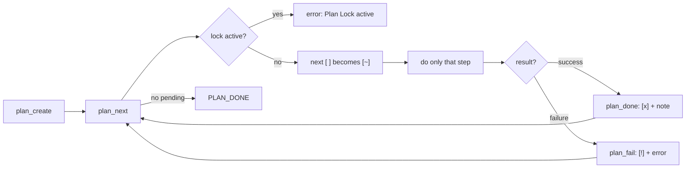
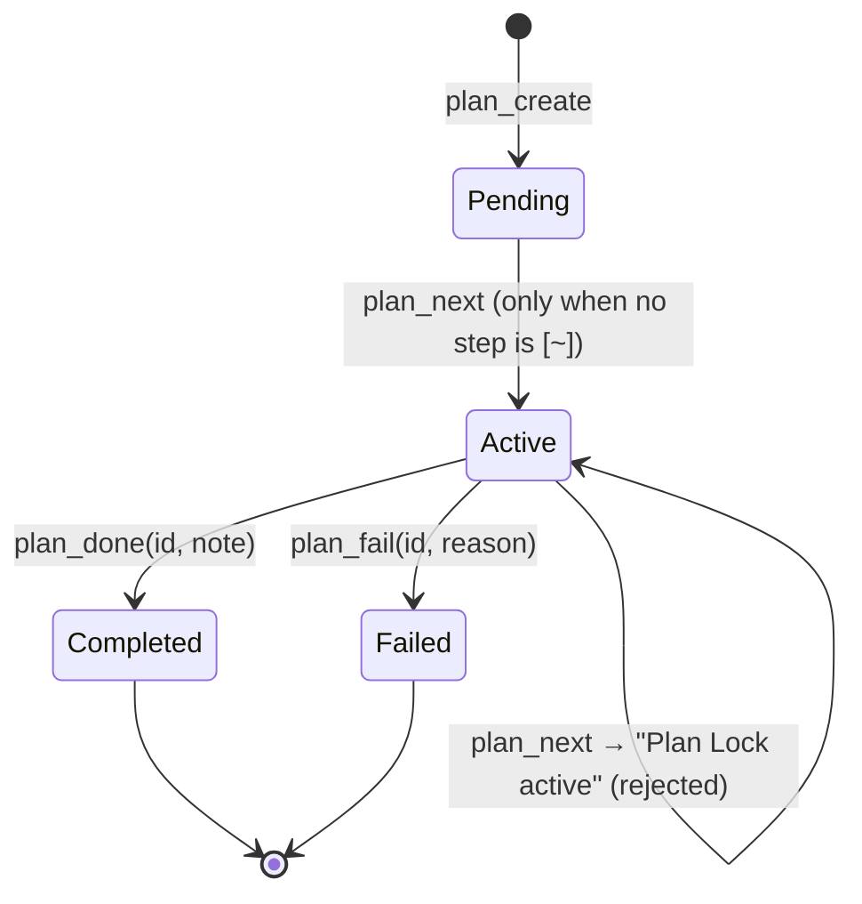
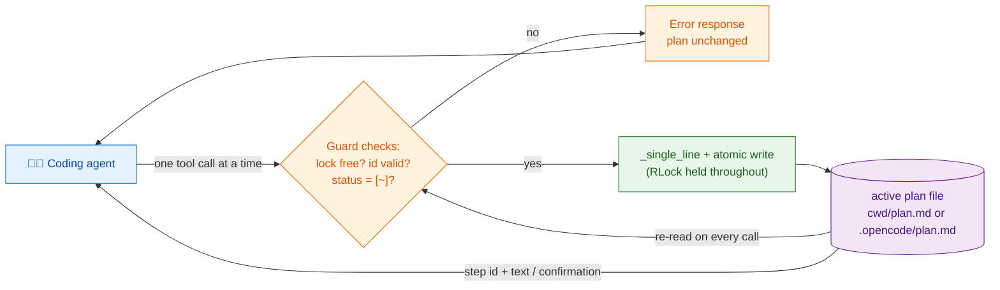

# Plan Lock MCP

[](https://github.com/mahirfatih/planlock-mcp/actions/workflows/ci.yml)


Plan Lock MCP makes an LLM work through a markdown plan one atomic step at a time, holding a lock on the active step until it is resolved.

[English](./README.md) | [Türkçe](./README.tr.md)

---

## 🎯 The problem

Local coding models — especially the 30B class such as Qwen3-Coder — tend to emit eight to ten tool and shell calls in a single turn when asked to change code. Every call returns its output into the same conversation. The context window fills with interleaved command output, it becomes hard to tell which result belongs to which command, and a failed step is buried next to unrelated successful ones.

On the following turn the model has to re-derive "where was I" from that noisy history. On local hardware this is expensive: the KV cache is extended with tokens that describe bookkeeping rather than progress.

The result is slower and more chaotic work. Parallelism is often presented as a speedup, but for a local LLM it usually does the opposite: more output to parse, more state to reconcile, and a higher chance that one failing call invalidates the others.

### Naming the failure mode

The technical term for emitting several tool calls in one turn is **parallel tool calling**. The failure described above is narrower: the calls have no dependency order. We call it **uncoordinated fan-out** — also described as *tool call flooding* or *over-eager tool use*. When the same turn edits several files it becomes *fan-out editing* or *scattergun editing*: shots go everywhere without sequencing. The conversation then ends up in **context thrashing** (*state thrashing*), where results interleave and state keeps changing without settling. Parallelism is not the problem; the missing coordination is. Plan Lock replaces that fan-out with one explicit transition at a time.

> **In short:** the tool layer, not the prompt, decides which step may run now. Everything else waits.

---

## 📖 Overview

| Source | Reference |
| :--- | :--- |
| 📄 Active plan | `<cwd>/plan.md` in a project root, `<cwd>/.opencode/plan.md` elsewhere |
| 🧩 MCP surface | `plan_create`, `plan_next`, `plan_done`, `plan_fail` over stdio |
| 🔒 Lock rule | at most one `[~]` step per server process |
| 🗃️ Ignore rules | root `.gitignore` or `.opencode/.gitignore`, created when missing |

> ⚡ **In one line:** create a plan, activate one step, resolve it, repeat. The
> markdown file is the source of truth and the server enforces the transition.
> Nothing else is written.

---

## 💡 The idea

- **One atomic, verifiable step at a time.** A step has a clear boundary: it is started, then either completed with a note or failed with a reason.
- **The plan lives outside the model.** It is a markdown file, not a conversation history. The model re-reads it when it needs state instead of carrying the whole task history in context.
- **The lock is enforced by the server, not by the prompt.** While a step is `[~]`, `plan_next` refuses to activate another one. Discipline is a property of the tool layer.
- **Transitions are idempotent and crash-safe:** `[ ]` → `[~]` → `[x]` / `[!]`. State is on disk, so after a crash or restart the model continues from the marked step rather than guessing.

---

## ✨ Features

- 🔒 **Enforced lock** — one `[~]` step at a time, checked by the server on every call.
- 📄 **External memory** — the plan is a markdown file, not conversation state.
- 🛡️ **Crash-safe writes** — temp file, fsync and `os.replace` under a serialized lock.
- 📁 **Project-aware location** — root `plan.md` when project markers exist, otherwise `.opencode/plan.md`.
- 🧭 **Absolute path in responses** — the model never has to search for the active file.
- 🧪 **70 tests, seven categories** — Smoke, Sanity, Unit, Regression, Integration, E2E and UI, plus GitHub Actions CI.
- 🌐 **English and Türkçe docs** — both tours stay in sync.

---

## 🧠 How it works

### 1. The loop

1. `plan_create(steps)` writes a fresh plan and backs up any previous one.
2. `plan_next()` activates the first pending step and returns its id, the absolute plan path and its text:
   `Next step (id=1, file: /home/user/projects/api/plan.md): Create database schema`.
3. The model does only that step, then calls `plan_done(id, note)` or `plan_fail(id, reason)`.
4. Repeat. `plan_next()` returns `PLAN_DONE` when no pending steps remain.



### 2. Tool contract

| Tool | Parameters | Behaviour |
| :--- | :--- | :--- |
| `plan_create` | `steps: list[str]` | Writes the plan file (root `plan.md` or `.opencode/plan.md`), prepares the ignore rules, backs up an existing plan, and returns the absolute path. |
| `plan_next` | none | Activates the next `[ ]` step as `[~]` and returns `id`, the absolute plan path and the step text. Returns an error if a step is already `[~]`, or `PLAN_DONE` when finished. |
| `plan_done` | `id: int, note: str` | Marks the active `[~]` step as `[x]` and appends the note. |
| `plan_fail` | `id: int, reason: str` | Marks the active `[~]` step as `[!]` and appends the reason. |

A step cannot be started twice: the server checks the active lock before activating anything else. Completed and failed steps are terminal.

### 3. Step states



Only one step can be `Active` at a time. `Completed` and `Failed` are terminal: `[x]` carries a `— note:` suffix and `[!]` a `— error:` suffix. `plan_create` resets the cycle and backs up the previous file.

---

## 🗂️ What gets pulled from where

| Source | What | Target |
| :--- | :--- | :--- |
| 🧑‍💻 Agent | `steps` passed to `plan_create` | new plan file, with a backup of the previous one |
| 📄 Active plan | first pending `[ ]` id and text, plus any `[~]` lock | `plan_next` response |
| 🖊️ Tool arguments | `note` or `reason`, collapsed to one line | `[x] — note:` or `[!] — error:` suffix |
| 📁 Working directory | project markers such as `.git` or `pyproject.toml` | root `plan.md` or `.opencode/plan.md` |
| 🗃️ Existing ignore files | entries already present | no duplicates added by `plan_create` |

The example plan in [`examples/plan.md`](./examples/plan.md) shows the exact
format the server writes. No network or external model catalog is consulted.

---

## 🤖 Current free chat models

Plan Lock does not publish or filter a model catalog. The live free chat model
list lives in [check-opencode-free-models](https://github.com/mahirfatih/check-opencode-free-models),
which keeps `~/.config/opencode/opencode.jsonc` in sync with the OpenCode
Console. Plan Lock consumes the MCP surface described above and never changes
model configuration.

---

## 📂 Plan file

### Location rule

The plan sits next to the code when the working directory looks like a project root: it contains `.git`, `pyproject.toml`, `package.json`, `Cargo.toml` or `go.mod`. Any other directory, such as a scratch folder or a home directory, keeps the plan in `.opencode/`, where a loose markdown file is less intrusive.

| Working directory | Plan file | Ignore rules |
| :--- | :--- | :--- |
| Project root (marker present) | `<cwd>/plan.md` | `<cwd>/.gitignore`, created when missing |
| Other directory | `<cwd>/.opencode/plan.md` | `.opencode/.gitignore` |

Both paths are relative to the server's working directory and nothing is written to the home directory, so each project keeps its own independent plan. `plan_create` reports the absolute path it wrote:

```text
Plan Lock created: 3 steps -> /home/user/projects/api/plan.md
```

The model always knows which file is the source of truth without searching for it.

### Format

```markdown
# Plan — myproject
- created: 1732451234

- [ ] 1. Create database schema
- [~] 2. Implement API endpoints
- [x] 3. Configure authentication — note: JWT tokens configured
- [!] 4. Set up Redis cache — error: Connection timeout
```

The header records the project name (basename of the working directory) and the creation time as a unix timestamp.

| Marker | Meaning |
| :---: | :--- |
| `[ ]` | Pending. |
| `[~]` | Active (locked). At most one step may have this marker. |
| `[x]` | Completed, with a `— note:` suffix. Terminal. |
| `[!]` | Failed, with a `— error:` suffix. Terminal. |

A real, fully completed plan from the macOS project `media-studio` is kept in [`examples/plan.md`](./examples/plan.md). It shows six resolved steps, each with a note; that project reported 441 tests passing and a clean build.

### Backup and ignore handling

`plan_create` also keeps the plan out of version control. A root-level plan is added to the working directory's `.gitignore`, which is created when missing; existing lines are preserved and entries are never duplicated. The `.opencode/` fallback gets its own `.opencode/.gitignore` with `plan.md`, `plan.md.bak` and `.gitignore` itself. Either way the plan and its backup never show up as untracked. When a new plan replaces an old one, the old content is written to the backup file next to it first.

---

## 🏗️ Architecture

Plan Lock MCP is a thin enforcement layer around one markdown file. The model carries no plan state in memory: every tool call re-reads the active plan file, validates the requested transition, and writes the whole file back atomically. The file is the source of truth; the server is the referee.



How to read it:

- **The agent only sends requests.** It never edits the plan file itself; the server writes it.
- **The guard is the discipline.** While a step is `[~]`, `plan_next` is rejected; `plan_done` / `plan_fail` require a matching active id.
- **The plan is the memory.** Each call starts by reading the file, so a crash or restart loses nothing.
- **Writes are atomic and serialized.** `tempfile.mkstemp` + `os.replace` under `threading.RLock` prevent partial files and double activation.

---

## 🚀 Quick start

### 1. Requirements

| Requirement | Notes |
| :--- | :--- |
| Python | 3.10+, with the runtime dependency `mcp` |
| MCP client | OpenCode Desktop or another stdio MCP client |
| Working directory | a project root or a scratch folder; `cwd` selects the plan location |

### 2. Run

```bash
pip install .                   # provides the `planlock` console script
planlock --version              # prints planlock 1.0.0
python3 /path/to/planlock.py    # starts the stdio MCP server
```

Register the server with the MCP client (for example `opencode.json`):

```json
{
  "mcp": {
    "planlock": {
      "type": "local",
      "command": ["python3", "/path/to/planlock.py"],
      "cwd": ".",
      "enabled": true
    }
  }
}
```

The `cwd` matters: it decides which project the server belongs to, and whether the plan sits at the project root or under `.opencode/`.

### 3. Flags

| Flag or entry point | Effect |
| :--- | :--- |
| *(none)* | Start the MCP server on stdio. |
| `--version` | Print the version and exit without starting the server. |
| `plan_create(steps)` | Write a fresh plan and report its absolute path. |
| `plan_next()` | Activate the next pending step or report `PLAN_DONE`. |
| `plan_done(id, note)` / `plan_fail(id, reason)` | Resolve the active step. |

### 4. Example output

```text
Plan Lock created: 3 steps -> /home/user/projects/api/plan.md
Next step (id=1, file: /home/user/projects/api/plan.md): Create database schema
Step 1 completed: schema written
Next step (id=2, file: /home/user/projects/api/plan.md): Implement API endpoints
PLAN_DONE
```

### 5. Agent prompt

Add this directive to the agent's system prompt:

```text
Plan Lock MCP is active. Call only one tool at a time.
Before starting a coding task, call plan_create.
Before each step, call plan_next and work only on the step it returns.
When the step finishes, call plan_done, or plan_fail if it failed.
Do not call other tools while a step is active.
If in doubt, read the plan file at the path plan_create reported.
```

The prompt is a reminder, not the enforcement. The lock itself is in the server.

---

## ⏰ Desktop & crontab

Plan Lock is driven by the MCP client, not by a schedule. In OpenCode Desktop,
register the server with `cwd` pointed at the project; each tool call re-reads
the active plan, so no crontab entry is needed. A scheduled job may read the
reported plan path to report a step stuck as `[~]`, but it must not edit the
plan. Resolving a step belongs to `plan_done` or `plan_fail`.

---

## 📂 Project structure

```text
planlock-mcp/
├── planlock.py                  # MCP server: the four tools and the file lock
├── pyproject.toml               # Package metadata, entry point, dependencies
├── py.typed                     # PEP 561 marker for type checkers
├── pytest.ini                   # Collects test_*.py and *-tests.py
├── .ruff.toml                   # Lint configuration
├── .pre-commit-config.yaml      # Local hook configuration
├── requirements.txt             # Runtime dependency (mcp)
├── requirements-dev.txt         # Test and lint dependencies
├── README.md                    # English tour
├── README.tr.md                 # Turkish tour
├── CHANGELOG.md                 # Release history
├── CONTRIBUTING.md              # Development conventions
├── SECURITY.md                  # Vulnerability reporting policy
├── LICENSE                      # MIT license
├── .github/workflows/ci.yml     # Lint and test on push and pull request
├── docs/
│   ├── README.md                # Documentation index
│   ├── guides/RELEASING.md      # Version bump and publish procedure
│   └── testing/TESTING.md       # Suite map and runner flags
├── examples/plan.md             # A real completed plan in server format
└── test/
    ├── test.sh                  # Runner: Ruff + pytest
    ├── README.md                # Test folder guide
    └── py/                      # Eight test files, 70 cases
```

Generated and local state (`.venv/`, caches, `dist/`, `uv.lock`, `.wrongstack/`) is gitignored and left out of the tree.

---

## 🧱 Design notes

- **`threading.RLock` with a decorator** serializes each read-check-write cycle inside one server process, so two simultaneous tool calls cannot both see an unlocked plan and activate the same step.
- **Atomic writes** use `tempfile.mkstemp` in the target directory plus `os.replace`. The temporary file and the directory are fsynced, so a crash or power loss cannot leave a half-written or vanished plan, and the rename stays on the same filesystem.
- **`_single_line`** collapses whitespace in step text, notes, and reasons. A newline in a tool argument cannot inject a forged `- [~]` line and bypass the lock.
- **No in-memory plan state.** Every call re-reads the file, which keeps restarts simple and makes the on-disk plan the single source of truth.
- **Clean stdio.** Nothing is printed to `stdout`; diagnostics do not corrupt the MCP transport.

---

## 🧪 Testing & CI

The suite has 70 deterministic tests, all offline. They are grouped into seven
categories, following the layered model used by `check-opencode-free-models`:

| Category | Flag | Scope |
| :--- | :--- | :--- |
| 💨 Smoke | `--smoke` | Compile, load, register tools, golden path, `--version`. |
| ✅ Sanity | `--sanity` | Exact messages, header format, plan locations. |
| 🔬 Unit | `--unit` | Tool behaviour in a fresh temporary directory. |
| 🩹 Regression | `--regression` | Injection, concurrency and durability fixes. |
| 🔗 Integration | `--integration` | Multi-call flows verified on disk. |
| 🎯 E2E | `--e2e` | Real stdio JSON-RPC transport. |
| 🖥️ UI | `--ui` | User-facing MCP client surface (no GUI exists). |

```bash
./test/test.sh                                   # Ruff + pytest
./test/test.sh --no-install                      # skip dependency installation
./test/test.sh --ui                              # one category, e.g. automated UI
```

The full suite map and flags live in [`docs/testing/TESTING.md`](./docs/testing/TESTING.md).
CI runs Ruff and the full suite on every push to `main` and on pull requests.

---

## ⚠️ Limitations

The prompt does not make the model perfectly disciplined. It can still decide to skip the plan, work on a later step, or forget to release a lock. The MCP checks make this visible rather than silent: an out-of-order step is rejected instead of quietly corrupting the plan. Recovery is manual but cheap: read the plan file at the path `plan_create` returned, see the `[~]` step, and either finish it with `plan_done` or record the failure with `plan_fail`.

The lock is per server process. Two independent server processes pointed at the same working directory are not serialized against each other. There is also no validation of a plan file that was edited by hand into an invalid shape, such as more than one `[~]` step or ids that skip numbers; `plan_create` always writes a well-formed plan, but hand-edited files can confuse the parser. A duplicated id is tolerated: `plan_done` and `plan_fail` prefer the active line, so the lock can still be released.

---

## 📚 Documentation

| Document | Purpose |
| :--- | :--- |
| [`docs/README.md`](./docs/README.md) | Index of the repository documentation. |
| [`CONTRIBUTING.md`](./CONTRIBUTING.md) | Setup, test and commit conventions. |
| [`CHANGELOG.md`](./CHANGELOG.md) | Release history. |
| [`SECURITY.md`](./SECURITY.md) | Vulnerability reporting policy. |
| [`LICENSE`](./LICENSE) | MIT license. |

---

## 🔮 Roadmap

- **✅ Done:** four MCP tools, enforced lock, atomic fsync-backed writes, backup
  and ignore handling, seven test categories, CI, and English and Türkçe tours.
- **Remaining:** cross-process locking for multiple server processes on one
  working directory, stricter validation of hand-edited plans, and optional
  read-only CLI inspection of the active plan.

---

## 📄 License

MIT. See [`LICENSE`](./LICENSE).
