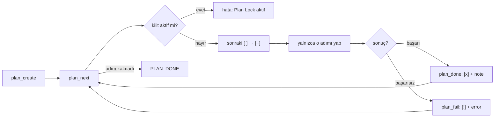
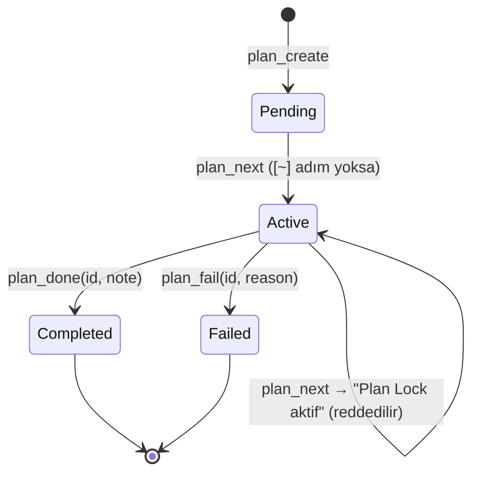
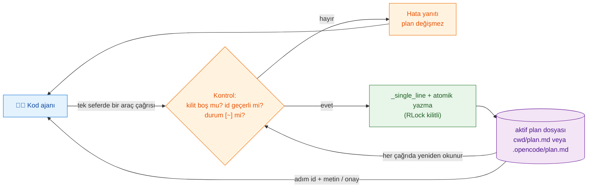

# Plan Lock MCP 🔒

[](https://github.com/mahirfatih/planlock-mcp/actions/workflows/ci.yml)


[English](./README.md) | **Türkçe**

> **Plan Lock MCP — yerel LLM'ler için tek adımlık plan yürütme kilidi (MCP sunucusu).**

Plan Lock MCP, markdown plan dosyaları üzerinde çalışan yerel/otonom kod ajanları
(OpenCode, Claude Code vb.) için Model Context Protocol (MCP) sunucusudur.
Açık bir **kilit mekanizması** ile ajanın aynı anda birden fazla adımı başlatmasını
engeller.

---

## 🎯 Neden var?

Otonom ajanlar tüm görev listesini gördüğünde öne atlama, birden fazla adımı aynı
anda yapma ya da doğrulama adımlarını atlama eğilimindedir. Bu durum hata
teşhisini zorlaştırır, model odağını zayıflatır ve dosyalar arasında bozuk
ara durumlar bırakır.

Aynı turda sekiz on kabuk komutu üretmek yerel modellerde yaygındır (örneğin
Qwen3-Coder sınıfı). Her çağrının çıktısı aynı konuşmaya döner; sonuçlar iç içe
girer, hangi çıktının hangi komuta ait olduğu zorlaşır ve başarısız bir adım
alakasız başarıların arasında kalır. Sonraki turda model "nerede kaldım?" sorusunu
bu gürültülü geçmişten yeniden çıkarmak zorundadır. Yerel donanımda bu pahalıdır:
KV cache, ilerleme yerine muhasebeyi anlatan token'larla büyür.

**Sorunun adı:** Aynı turda birden fazla araç çağrısı üretmenin teknik adı
**parallel tool calling**'dir. Buradaki mesele paralellik değil, çağrılar arasında
bağımlılık sırası olmamasıdır: buna **koordinesiz fan-out** (*tool call flooding*
veya *over-eager tool use*) diyoruz. Aynı turda birden fazla dosya düzenlenirse
bu *fan-out editing* ya da *scattergun editing* olur — her yere aynı anda sıkılır,
sıra yoktur. Sonuç **context thrashing** (*state thrashing*) olur: çıktılar iç
içe girer, state sürekli değişir ve oturmaz; context ilerleme yerine muhasebeyle
dolar. Plan Lock bu fan-out'u tek ve açık bir geçişle değiştirir.

> **Kısacası:** hangi adımın çalışabileceğine prompt değil, araç katmanı karar
> verir. Diğer her şey bekler.

---

## 💡 Temel fikir

- **Tek ve doğrulanabilir adım.** Adım başlar, sonra notla tamamlanır ya da sebeple başarısız olur.
- **Plan modelin dışında yaşar.** Konuşma geçmişi değil, markdown dosyasıdır; model duruma ihtiyaç duyduğunda dosyayı yeniden okur.
- **Kilit prompt'la değil, sunucuyla zorlanır.** Bir adım `[~]` iken `plan_next` yeni adım açmayı reddeder.
- **Geçişler tekrarlanabilir ve çökmeye dayanıklıdır:** `[ ]` → `[~]` → `[x]` / `[!]`. Durum diskte tutulur; çökme sonrası model tahmin etmek yerine işaretli adımdan devam eder.

**Çözüm:** Bir madde aktif (`[~]`) iken **başka hiçbir madde başlatılamaz**. Ajan
maddeyi ya temiz biçimde tamamlamalı (`plan_done`) ya da başarısızlığı
bildirmelidir (`plan_fail`). Kilit serbest bırakıldıktan sonra sıradaki adım
`plan_next` ile açılabilir.

---

## ⚙️ Nasıl çalışır?

### 1. Döngü

1. `plan_create(steps)` yeni bir plan yazar, varsa eskisini yedekler.
2. `plan_next()` sıradaki bekleyen maddeyi `[~]` yapar ve id'sini, plan dosyasının
   tam yolunu ve metnini döner:
   `Next step (id=1, file: /home/user/projeler/api/plan.md): Veritabanı şemasını oluştur`.
3. Model **yalnızca o adımı** yapar, ardından `plan_done(id, note)` ya da
   `plan_fail(id, reason)` çağırır.
4. Tekrar edilir. Bekleyen madde kalmazsa `plan_next()` → `PLAN_DONE`.



### 2. Araç sözleşmesi

| Araç | Parametreler | Açıklama |
| :--- | :--- | :--- |
| `plan_create` | `steps: list[str]` | Plan dosyasını yazar (kök `plan.md` veya `.opencode/plan.md`), ignore kurallarını hazırlar, eski planı yedekler ve dosyanın tam yolunu döner. |
| `plan_next` | *(yok)* | Sıradaki `[ ]` maddesini `[~]` yapar; id'yi, plan dosyasının tam yolunu ve metni döner. Kilit varsa hata, plan biterse `PLAN_DONE` döner. |
| `plan_done` | `id: int, note: str` | Aktif maddeyi `[x]` yapar ve not ekler. |
| `plan_fail` | `id: int, reason: str` | Aktif maddeyi `[!]` yapar ve sebep ekler. |

Aynı adım iki kez başlatılamaz: sunucu yeni bir adım açmadan önce aktif kilidi
kontrol eder. Tamamlanan ve başarısız adımlar terminal durumdur.

### 3. Adım durumları



Aynı anda yalnızca bir adım `Active` olabilir. `Completed` ve `Failed` terminal
durumlardır: `[x]` `— note:`, `[!]` ise `— error:` eki taşır. `plan_create` döngüyü
sıfırlar ve önceki dosyayı yedekler.

---

## 📂 Dosya ve yol yapısı

### Konum kuralı

Plan dosyası, çalışma dizini bir proje köküne benziyorsa (`.git`,
`pyproject.toml`, `package.json`, `Cargo.toml` veya `go.mod` içeriyorsa)
**`<cwd>/plan.md`** olarak kodun yanında tutulur. Diğer dizinlerde (geçici
klasör, ev dizini) **`<cwd>/.opencode/plan.md`** kullanılır.

| Çalışma dizini | Plan dosyası | Ignore kuralları |
| :--- | :--- | :--- |
| Proje kökü (işaret var) | `<cwd>/plan.md` | `<cwd>/.gitignore`, yoksa oluşturulur |
| Diğer dizin | `<cwd>/.opencode/plan.md` | `.opencode/.gitignore` |

Sabit yol yoktur, ev dizinine yazılmaz; her proje kendi planını tutar.
`plan_create`, yazdığı dosyanın tam yolunu döner:
`Plan Lock created: 3 steps -> /home/user/projeler/api/plan.md`. Böylece model
hangi dosyanın doğruluk kaynağı olduğunu aramadan bilir.

### Plan formatı

```markdown
# Plan — projem
- created: 1732451234

- [ ] 1. Veritabanı şemasını oluştur
- [~] 2. API uç noktalarını yaz
- [x] 3. Kimlik doğrulamayı kur — note: JWT yapılandırıldı
- [!] 4. Redis önbelleğini kur — error: Bağlantı zaman aşımı
```

Başlık, proje adını (çalışma dizininin adı) ve oluşturma zamanını unix timestamp olarak kaydeder.

| Sembol | Durum | Açıklama |
| :---: | :--- | :--- |
| `[ ]` | Bekliyor | Adım başlamadı. |
| `[~]` | Aktif (kilitli) | Aynı anda **en fazla bir** adım `[~]` olabilir. |
| `[x]` | Tamamlandı | Terminal durum, kısa not eklenir. Değiştirilemez. |
| `[!]` | Başarısız | Terminal durum, sebep eklenir. Değiştirilemez. |

Gerçek bir örnek, macOS projesi `media-studio`'nun tamamlanmış planı:
[`examples/plan.md`](./examples/plan.md). Altı adımın hepsi çözülmüş ve her birinde
not var; o projede 441 test geçmiş, build temiz.

### Yedekleme ve ignore

Yeni plan oluşturulurken mevcut plan, plan dosyasının yanındaki `.bak` dosyasına
yedeklenir. Kök planda `plan.md` ve `plan.md.bak`, çalışma dizinindeki `.gitignore`
dosyasına eklenir; dosya yoksa önce oluşturulur. Mevcut satırlar korunur, aynı girdi
tekrar eklenmez. `.opencode/` düzeninde ise `.opencode/.gitignore` otomatik
olarak `plan.md`, `plan.md.bak` ve `.gitignore` girdileriyle güncellenir. Her
iki durumda da plan ve yedeği `git status` çıktısında görünmez.

---

## 🏗️ Mimari

Plan Lock MCP, tek bir markdown dosyası etrafında çalışan ince bir zorlama katmanıdır.
Model planda durum tutmaz: her araç çağrısı aktif plan dosyasını yeniden
okur, istenen geçişi doğrular ve dosyanın tamamını atomik olarak yazar. Dosya
tek doğruluk kaynağı, sunucu ise hakemdir.



Diyagramı okuma:

- **Ajan yalnızca istek gönderir.** Plan dosyasını kendisi düzenlemez; sunucu yazar.
- **Kontrol, disiplini zorlar.** Bir adım `[~]` iken `plan_next` reddedilir;
  `plan_done` / `plan_fail` eşleşen aktif id ister.
- **Plan, hafızadır.** Her çağrı dosyayı okuyarak başlar; çökme veya yeniden
  başlatma kayıp değildir.
- **Yazmalar atomik ve serileştirilmiştir.** `threading.RLock` altında
  `tempfile.mkstemp` + `os.replace`, yarım dosya ve çift aktivasyonu engeller.

---

## 🚀 Kurulum

### 1. Paket

```bash
uv tool install .        # veya: pip install .
planlock                 # konsol komutu
```

Kurulumu `planlock --version` ile doğrulayabilirsin (`planlock 1.0.0` yazar).

### 2. MCP istemcisi

MCP istemci yapılandırması (`opencode.json`):

```json
{
  "mcp": {
    "planlock": {
      "type": "local",
      "command": ["python3", "/path/to/planlock.py"],
      "cwd": ".",
      "enabled": true
    }
  }
}
```

`cwd` önemlidir: sunucunun hangi projeye ait olduğunu ve planın proje kökünde mi
yoksa `.opencode/` altında mı duracağını belirler.

### 3. Ajan promptu

Ajan sistem promptuna eklenecek kural:

```text
Plan Lock MCP etkin. Aynı anda YALNIZCA 1 araç çağırabilirsin.
Yeni bir kodlama görevi öncesi plan_create çağır.
Her adımdan önce plan_next çağır ve yalnızca dönen adım üzerinde çalış.
Adım bitince plan_done (başarısızsa plan_fail) çağır.
Aktif madde varken başka araç çağırma.
Şüpheye düşersen plan_create'ın bildirdiği yoldaki plan dosyasını oku.
```

Prompt yalnızca hatırlatmadır; kilidi sunucu uygular.

---

## 🧱 Tasarım notları

- **`threading.RLock` dekoratörü**, aynı sunucu sürecinde okuma-kontrol-yazma
  döngüsünü serileştirir; eşzamanlı iki çağrı aynı adımı açamaz.
- **Atomik yazma** hedef dizinde `tempfile.mkstemp` + `os.replace` kullanır.
  Geçici dosya ve dizin fsync edilir; çökme veya güç kesintisi yarım dosya
  bırakmaz, rename aynı dosya sistemi içinde kalır.
- **`_single_line`** adım metnindeki, nottaki ve sebepteki boşlukları tek satıra
  indirger; argümandaki satır sonu sahte `- [~]` satırı enjekte edemez.
- **Bellekte plan durumu yoktur.** Her çağrı dosyayı yeniden okur; yeniden
  başlatma basittir, diskteki plan tek doğruluk kaynağıdır.
- **Temiz stdio.** `stdout`'a log basılmaz; MCP taşıması bozulmaz.

---

## 🧪 Test ve katkı

62 deterministik test çevrimdışı çalışır.

```bash
./test/test.sh                 # Ruff + pytest
./test/test.sh --no-install    # bağımlılık kurulumunu atla
```

Test haritası ve tüm bayraklar: [`docs/testing/TESTING.md`](./docs/testing/TESTING.md).

---

## ⚠️ Sınırlar

Prompt modeli tamamen disiplinli hale getirmez. Planı atlayabilir, ilerideki bir
adıma geçebilir ya da kilidi bırakmayı unutabilir. MCP kontrolleri bunu sessiz
bırakmak yerine görünür kılar: sıra dışı adım reddedilir, plan sessizce bozulmaz.
Kurtarma el işi ama ucuzdur: `plan_create`'ın döndürdüğü yoldaki planı oku, `[~]`
adımı gör, ya `plan_done` ile bitir ya da `plan_fail` ile sebebi kaydet.

Kilit sunucu süreci başınadır. Aynı çalışma dizinine bakan iki bağımsız sunucu
süreci birbirine karşı serileştirilmez. Elle düzenlenmiş, birden fazla `[~]` adımı
ya da numara atlaması olan geçersiz bir plan için doğrulama yoktur;
`plan_create` daima düzgün bir plan yazar, elle düzenlenen dosyalar ayrıştırıcıyı
şaşırtabilir. Yinelenen id tolere edilir: `plan_done` ve `plan_fail` aktif satırı
tercih eder, böylece kilit yine bırakılabilir.

---

## 📚 Belgeler

| Belge | Amaç |
| :--- | :--- |
| [`docs/README.md`](./docs/README.md) | Depo belgelerinin dizini. |
| [`CONTRIBUTING.md`](./CONTRIBUTING.md) | Kurulum, test ve commit kuralları. |
| [`CHANGELOG.md`](./CHANGELOG.md) | Sürüm geçmişi. |
| [`SECURITY.md`](./SECURITY.md) | Güvenlik açığı bildirme politikası. |
| [`LICENSE`](./LICENSE) | MIT lisansı. |
