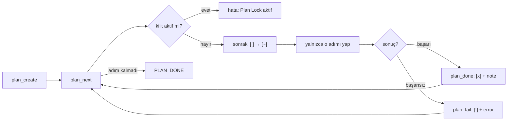
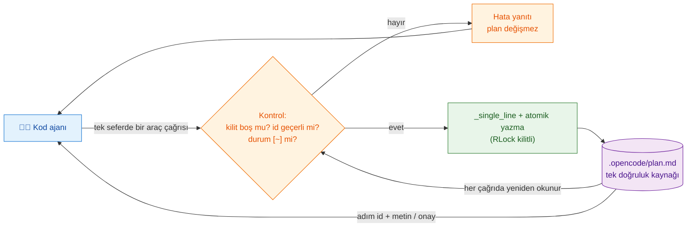
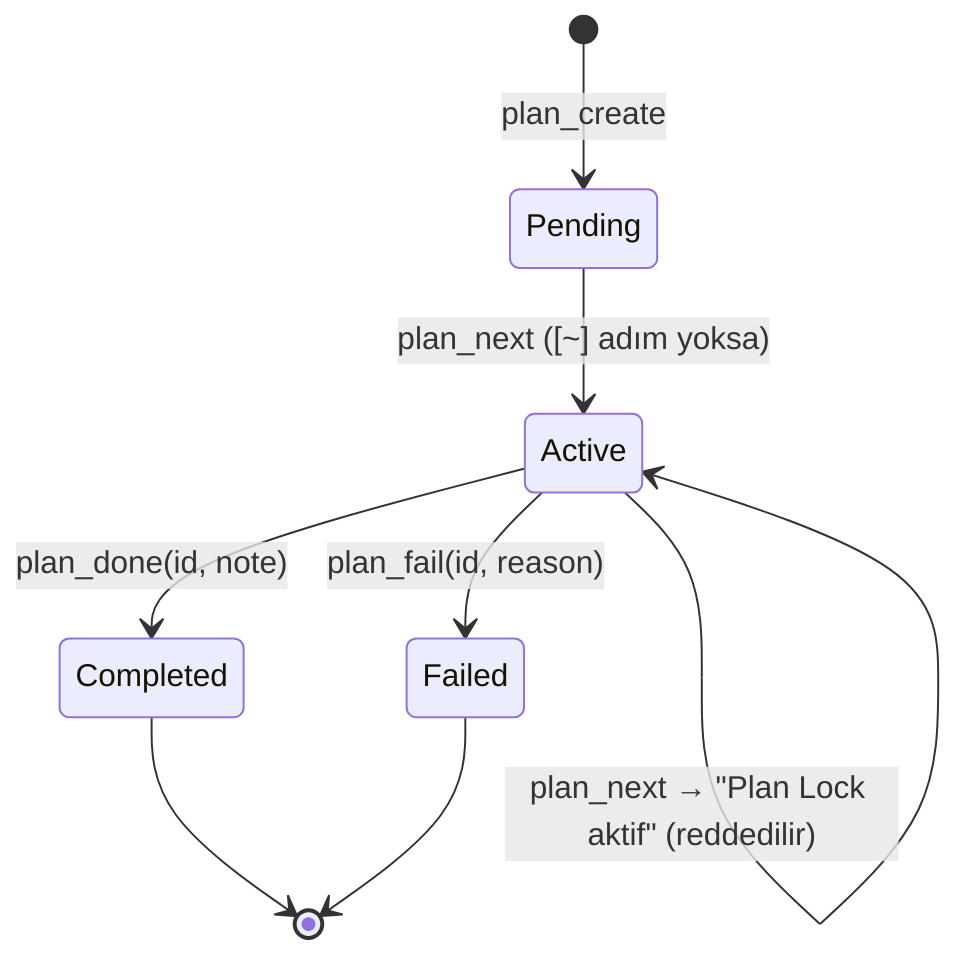

# Plan Lock MCP 🔒


[English](./README.md) | **Türkçe**

> **Plan Lock MCP — yerel LLM'ler için tek adımlık plan yürütme kilidi (MCP sunucusu).**

Plan Lock MCP, markdown plan dosyaları üzerinde çalışan yerel/otonom kod ajanları
(OpenCode, Claude Code vb.) için Model Context Protocol (MCP) sunucusudur.
Açık bir **kilit mekanizması** ile ajanın aynı anda birden fazla adımı başlatmasını
engeller.

---

## 🎯 Neden var?

Otonom ajanlar tüm görev listesini gördüğünde öne atlama, birden fazla adımı aynı
anda yapma ya da doğrulama adımlarını atlama eğilimindedir. Bu durum hata
teşhisini zorlaştırır, model odağını zayıflatır ve dosyalar arasında bozuk
ara durumlar bırakır.

**Çözüm:** Bir madde aktif (`[~]`) iken **başka hiçbir madde başlatılamaz**. Ajan
maddeyi ya temiz biçimde tamamlamalı (`plan_done`) ya da başarısızlığı
bildirmelidir (`plan_fail`). Kilit serbest bırakıldıktan sonra sıradaki adım
`plan_next` ile açılabilir.

---

## ⚙️ Nasıl çalışır?

1. `plan_create(steps)` yeni bir plan yazar, varsa eskisini yedekler.
2. `plan_next()` sıradaki bekleyen maddeyi `[~]` yapar ve id'siyle metnini döner.
3. Model **yalnızca o adımı** yapar, ardından `plan_done(id, note)` ya da
   `plan_fail(id, reason)` çağırır.
4. Tekrar edilir. Bekleyen madde kalmazsa `plan_next()` → `PLAN_DONE`.



---

## 📂 Dosya ve yol yapısı

- Plan dosyası çalışma dizinine göre **`.opencode/plan.md`** konumundadır;
  sabit yol yoktur, ev dizinine yazılmaz. Her proje kendi planını tutar.
- Yeni plan oluşturulurken mevcut plan `.opencode/plan.md.bak` olarak yedeklenir.
- `.opencode/.gitignore` otomatik olarak `plan.md`, `plan.md.bak` ve `.gitignore`
  girdileriyle güncellenir; kök `.gitignore` değiştirilmez. Böylece üretilen
  `.opencode/` dizini `git status` çıktısında görünmez.
- Tüm yazımlar atomic'tir (`tempfile.mkstemp` + `os.replace`).
- Durum değişiklikleri `_STATE_LOCK` ile serileştirilir; eşzamanlı çağrılar aynı
  adımı açamaz.
- Kullanıcı girdisi tek satıra indirgenir; satır sonu ile sahte plan satırı
  enjekte edilemez.
- `stdout`'a log basılmaz; MCP stdio taşıması temiz kalır.

---

## 📝 Plan formatı

```markdown
# Plan — projem
- created: 1732451234

- [ ] 1. Veritabanı şemasını oluştur
- [~] 2. API uç noktalarını yaz
- [x] 3. Kimlik doğrulamayı kur — note: JWT yapılandırıldı
- [!] 4. Redis önbelleğini kur — error: Bağlantı zaman aşımı
```

Başlık, proje adını (çalışma dizininin adı) ve oluşturma zamanını unix timestamp olarak kaydeder.

| Sembol | Durum | Açıklama |
| :---: | :--- | :--- |
| `[ ]` | Bekliyor | Adım başlamadı. |
| `[~]` | Aktif (kilitli) | Aynı anda **en fazla bir** adım `[~]` olabilir. |
| `[x]` | Tamamlandı | Terminal durum, kısa not eklenir. Değiştirilemez. |
| `[!]` | Başarısız | Terminal durum, sebep eklenir. Değiştirilemez. |

---

## 🏗️ Mimari

Plan Lock MCP, tek bir markdown dosyası etrafında çalışan ince bir zorlama katmanıdır.
Model planda durum tutmaz: her araç çağrısı `.opencode/plan.md` dosyasını yeniden
okur, istenen geçişi doğrular ve dosyanın tamamını atomik olarak yazar. Dosya
tek doğruluk kaynağı, sunucu ise hakemdir.



Diyagramı okuma:

- **Ajan yalnızca istek gönderir.** Plan dosyasını kendisi düzenlemez; sunucu yazar.
- **Kontrol, disiplini zorlar.** Bir adım `[~]` iken `plan_next` reddedilir;
  `plan_done` / `plan_fail` eşleşen aktif id ister.
- **Plan, hafızadır.** Her çağrı dosyayı okuyarak başlar; çökme veya yeniden
  başlatma kayıp değildir.
- **Yazmalar atomik ve serileştirilmiştir.** `threading.RLock` altında
  `tempfile.mkstemp` + `os.replace`, yarım dosya ve çift aktivasyonu engeller.

### Adım durumları



Aynı anda yalnızca bir adım `Active` olabilir. `Completed` ve `Failed` terminal
durumlardır: `[x]` `— note:`, `[!]` ise `— error:` eki taşır. `plan_create` döngüyü
sıfırlar ve önceki dosyayı yedekler.

---

## 🛠️ MCP araçları

| Araç | Parametreler | Açıklama |
| :--- | :--- | :--- |
| `plan_create` | `steps: list[str]` | Yeni planı yazar, gitignore'u ayarlar, eski planı yedekler. |
| `plan_next` | *(yok)* | Sıradaki `[ ]` maddesini `[~]` yapar. Kilit varsa hata, plan biterse `PLAN_DONE` döner. |
| `plan_done` | `id: int, note: str` | Aktif maddeyi `[x]` yapar ve not ekler. |
| `plan_fail` | `id: int, reason: str` | Aktif maddeyi `[!]` yapar ve sebep ekler. |

---

## 🚀 Kurulum

Paket olarak:

```bash
uv tool install .        # veya: pip install .
planlock                 # konsol komutu
```

MCP istemci yapılandırması (`opencode.json`):

```json
{
  "mcp": {
    "planlock": {
      "type": "local",
      "command": ["python3", "/path/to/planlock.py"],
      "cwd": ".",
      "enabled": true
    }
  }
}
```

Ajan sistem promptuna eklenecek kural:

```text
Plan Lock MCP etkin. Aynı anda YALNIZCA 1 araç çağırabilirsin.
Yeni bir kodlama görevi öncesi plan_create çağır.
Her adımdan önce plan_next çağır ve yalnızca dönen adım üzerinde çalış.
Adım bitince plan_done (başarısızsa plan_fail) çağır.
Aktif madde varken başka araç çağırma.
```

---

## 🧪 Test ve katkı

```bash
./test/test.sh                 # Ruff + pytest
uv run --with pytest --with mcp pytest -q
```

Ayrıntılar: [`CONTRIBUTING.md`](./CONTRIBUTING.md),
[`docs/testing/TESTING.md`](./docs/testing/TESTING.md),
[`CHANGELOG.md`](./CHANGELOG.md). Lisans: MIT ([`LICENSE`](./LICENSE)).
